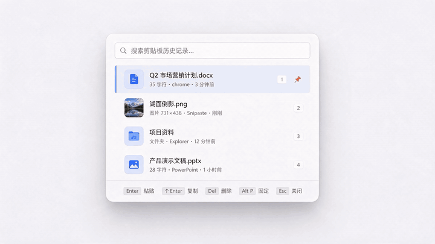

# WinMaccy

Windows 上的 [Maccy](https://github.com/p0deje/Maccy) 风格剪贴板历史管理器。轻量、开源、纯本地、不联网，C# / WPF / .NET 8 原生实现，零第三方依赖。

**下载**：见 [Releases](https://github.com/zhuba-Ahhh/WinMaccy/releases)，下载 `WinMaccy.exe` 单文件即用（自包含，免装运行时）。



<sub>演示为 AI 概念动画，高清 MP4 见 Release 附件 `winmaccy-demo.mp4`。</sub>

## 使用

默认快捷键 **Ctrl + Shift + C** 呼出搜索窗，输入即过滤，回车粘贴。

| 快捷键 | 功能 |
| --- | --- |
| `Enter` | 复制并自动粘贴 |
| `Shift+Enter` | 仅复制 |
| `Ctrl+Enter` | 纯文本粘贴 |
| `Ctrl+1..9` | 快速选择 |
| `Alt+P` | 置顶 / 取消置顶 |
| `Delete` | 删除该项 |
| `Ctrl+Shift+Delete` | 清空历史（保留置顶） |
| `Esc` / 点击外部 | 关闭 |

鼠标：单击复制，`Alt+单击` 粘贴，`Alt+Shift+单击` 纯文本粘贴；悬停行尾可直接固定/删除。

- 输入即模糊搜索（fzf 式子序列匹配），命中字符高亮
- 每条记录显示来源应用图标与名称、类型与时间
- 记录内容：文本、HTML/RTF 富文本、图片、文件（资源管理器复制）
- 相同内容自动去重；置顶项永久保留在顶部
- 托盘菜单：最近 6 条历史一键复制、暂停记录、忽略下一次复制、清空历史、设置
- 设置：热键录制、自动粘贴、开机自启、主题（浅/深/跟随系统）、页脚开关、历史上限、图片上限、按应用忽略

## 数据与隐私

- 默认存 `%APPDATA%\WinMaccy\`（`history.json`、`settings.json`、`images\`）
- 在 exe 旁建 `data\` 文件夹即切换为便携模式
- 排障：设环境变量 `WINMACCY_DEBUG=1`，日志写在数据目录 `debug.log`

要求 Windows 10 1809+ / Windows 11 x64。

## 构建

需 [.NET 8 SDK](https://dotnet.microsoft.com/download/dotnet/8.0)：

```powershell
dotnet publish src/WinMaccy/WinMaccy.csproj -c Release -r win-x64 `
  --self-contained true -p:PublishSingleFile=true `
  -p:IncludeNativeLibrariesForSelfExtract=true
```

推 `v*` 标签会触发 GitHub Actions 自动发布 Release。

## License

[MIT](LICENSE)。交互设计致敬 macOS 上的开源软件 Maccy。
